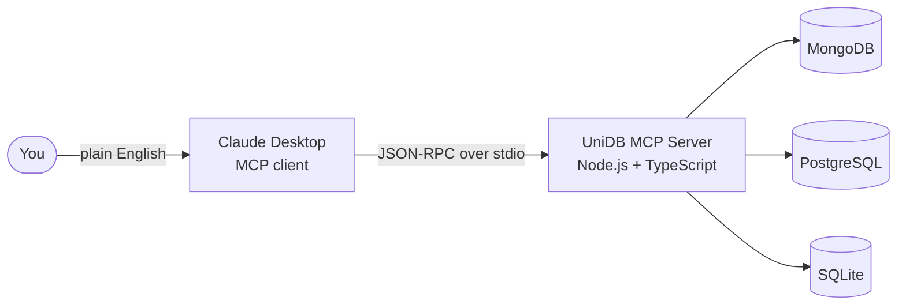

<div align="center">

# 🗄️ UniDB MCP

### One MCP server. Three databases. Zero context-switching.

**Let AI agents like Claude Desktop talk to MongoDB, PostgreSQL and SQLite in plain English.**


[Quick Start](#-quick-start) · [Tools](#-tools-reference) · [Configuration](#-configuration) · [Troubleshooting](#-troubleshooting) · [Roadmap](#-roadmap)

🌐 **Website & docs:** https://YOUR-SITE-URL

</div>

---

## 📖 Table of Contents

1. [What is UniDB MCP?](#-what-is-unidb-mcp)
2. [Features](#-features)
3. [How it works](#-how-it-works)
4. [Requirements](#-requirements)
5. [Quick Start](#-quick-start)
6. [Step-by-step setup](#-step-by-step-setup)
7. [Configuration](#-configuration)
8. [Tools reference](#-tools-reference)
9. [Example prompts](#-example-prompts)
10. [Project structure](#-project-structure)
11. [Development](#-development)
12. [Security notes & limitations](#-security-notes--limitations)
13. [Troubleshooting](#-troubleshooting)
14. [Lessons learned while building it](#-lessons-learned-while-building-it)
15. [Roadmap](#-roadmap)
16. [Author & License](#-author--license)

---

## 🧠 What is UniDB MCP?

**UniDB MCP** is a [Model Context Protocol](https://modelcontextprotocol.io) (MCP) server written in **TypeScript** that gives AI assistants a safe, structured way to work with your databases.

Instead of copying queries between a terminal and a chat window, you connect UniDB MCP to an MCP client such as **Claude Desktop**, and then just ask:

> *"Create a `users` table in PostgreSQL with id, name and email."*
> *"Insert a document for Ada Lovelace into MongoDB."*
> *"Show me every row in `orders` where status is pending."*

The assistant picks the right tool, UniDB MCP runs the operation against the right database, and the result comes back into the conversation.

> **Important:** UniDB MCP runs **locally on your machine** and connects to **your own** databases. Nothing is hosted for you — you clone it, configure it, and your AI client launches it on demand.

---

## ✨ Features

- 🔌 **Three databases, one server** — MongoDB, PostgreSQL and SQLite behind a single MCP connection.
- 🧰 **13 purpose-built tools** — create, read, update and delete across all three databases.
- 🗣️ **Natural language in, real operations out** — the AI client chooses the tool and fills in the arguments.
- 🔐 **No credentials in source code** — database settings come from environment variables / a `.env` file.
- 🧱 **Parameterized values** — row values are passed as query parameters, not string-concatenated into SQL.
- 🩺 **Readable errors** — database failures come back as tool results the AI can see and act on, not opaque protocol errors.
- 🪵 **Protocol-safe logging** — all logs go to `stderr`, so they never corrupt the JSON-RPC stream on `stdout`.
- 🚀 **Non-blocking startup** — the server connects to the MCP client first, then initializes databases in the background.
- 🧪 **Inspector-ready** — ships with an `npm run inspector` script for testing tools without an AI client.

---

## ⚙️ How it works



**Request lifecycle**

1. Claude Desktop starts the server as a child process (using the command in your config file) and talks to it over **stdio**.
2. The client calls `tools/list` and receives the 13 tool definitions with their JSON schemas.
3. When you ask for something, the model chooses a tool and sends a `tools/call` request with arguments.
4. UniDB MCP validates the arguments, runs the operation on the right database, and returns the result.
5. If something goes wrong (bad SQL, connection issue), the error message is returned as a tool result so the model can explain it or retry.

---

## 📋 Requirements

| Requirement | Notes |
|---|---|
| **Node.js 20+** | Needed to build and run the server. |
| **npm** | Comes with Node.js. |
| **Claude Desktop** (or another MCP client) | The app that launches and talks to the server. |
| **MongoDB** *(optional)* | Only needed for the MongoDB tools. |
| **PostgreSQL** *(optional)* | Only needed for the PostgreSQL tools. |
| **SQLite** | Bundled via `better-sqlite3`, no separate install. |

> 💡 You only need the databases you actually want to use. If one isn't running, its connection is logged as failed on startup and the other databases keep working.
>
> 🧪 The MCP Inspector (`npm run inspector`) needs **Node.js 22.19+**. The server itself runs fine on Node 20.

---

## 🚀 Quick Start

```bash
# 1. Clone and install
git clone https://github.com/YOUR_USERNAME/unidb-mcp.git
cd unidb-mcp
npm install

# 2. Create your environment file and fill in your own values
cp .env.example .env        # Windows (PowerShell): copy .env.example .env

# 3. Build
npm run build
```

Then add this to your `claude_desktop_config.json` (use the **absolute path** to your build):

```json
{
  "mcpServers": {
    "unidb-mcp": {
      "command": "node",
      "args": ["/absolute/path/to/unidb-mcp/build/index.js"]
    }
  }
}
```

Fully **quit and reopen Claude Desktop** and try: *"Read all documents from MongoDB."*

Want the detailed version? Keep reading. 👇

---

## 🛠️ Step-by-step setup

### Step 1 — Install prerequisites

- Install **Node.js 20 or newer** from [nodejs.org](https://nodejs.org) and check it:
  ```bash
  node -v
  npm -v
  ```
- Install and start the databases you want to use (MongoDB and/or PostgreSQL).
- Install **Claude Desktop**.

### Step 2 — Get the code

```bash
git clone https://github.com/YOUR_USERNAME/unidb-mcp.git
cd unidb-mcp
```

### Step 3 — Install dependencies

```bash
npm install
```

This installs the MCP SDK, the MongoDB and PostgreSQL drivers, `better-sqlite3` and `dotenv`.

### Step 4 — Create your `.env` file

Copy the example file and fill in **your own** values:

```bash
cp .env.example .env
```

```dotenv
# ---------- MongoDB ----------
MONGODB_URI=mongodb://localhost:27017/mydb
MONGODB_DB=mydb
MONGODB_COLLECTION=documents

# ---------- PostgreSQL ----------
PG_USER=postgres
PG_HOST=localhost
PG_DATABASE=mydb
PG_PASSWORD=your_password_here
PG_PORT=5432
```

> 🔒 `.env` is listed in `.gitignore`. **Never commit it** and never paste real passwords into issues, screenshots or chats.

### Step 5 — Configure SQLite

SQLite stores data in a single local file. In the current version the file location is set in `src/sqliteClient.ts`:

```ts
const absPath = path.resolve("/path/where/you/want/mydb.sqlite");
```

Open that file, replace the path with where you want your database file to live, and rebuild in the next step.

> 📌 Making this an environment variable is on the [roadmap](#-roadmap).

### Step 6 — Build

```bash
npm run build
```

This compiles `src/` into `build/`. You should see no errors. The entry point is `build/index.js`.

### Step 7 — (Optional) Test the server on its own

Run it directly to check that each database connects:

```bash
npm start
```

You should see status lines like these (they go to `stderr`):

```
🚀 MCP server connected
✅ MongoDB connected
✅ PostgreSQL connected
✅ SQLite connected
```

Stop it with `Ctrl + C`. A `❌ ... failed` line followed by an error tells you which database needs attention.

### Step 8 — Register the server with Claude Desktop

Open (or create) your `claude_desktop_config.json`:

| OS | Typical location |
|---|---|
| **Windows** | `%APPDATA%\Claude\claude_desktop_config.json` |
| **macOS** | `~/Library/Application Support/Claude/claude_desktop_config.json` |

> On some Windows installs (for example the Microsoft Store version) the folder lives elsewhere. If you can't find it, search your user folder for `claude_desktop_config.json`.

Add the server (**use absolute paths**, and forward slashes on Windows):

```json
{
  "mcpServers": {
    "unidb-mcp": {
      "command": "node",
      "args": ["C:/Users/you/projects/unidb-mcp/build/index.js"],
      "cwd": "C:/Users/you/projects/unidb-mcp"
    }
  }
}
```

The server reads your `.env` from the project root automatically, so you don't have to repeat the database settings here. If you prefer, you can put them in the config instead (see [Configuration](#-configuration)).

### Step 9 — Restart Claude Desktop completely

Closing the window is **not enough** — Claude Desktop keeps running in the background and keeps the old server process alive.

- **Windows:** right-click the Claude icon in the system tray → **Exit**, then reopen it.
- **macOS:** `Cmd + Q`, then reopen it.

Start a **new chat**. In Claude Desktop's connector settings you should see `unidb-mcp` with 13 tools.

### Step 10 — Try it

> *"Create a PostgreSQL table named `customers` with columns `id SERIAL PRIMARY KEY` and `name VARCHAR(255)`."*

Claude will show the tool call it's making. Approve it, and check the table in your database client.

---

## 🔧 Configuration

UniDB MCP is configured entirely through environment variables.

| Variable | Used by | Default | Description |
|---|---|---|---|
| `MONGODB_URI` | MongoDB | — | Connection string, e.g. `mongodb://localhost:27017/mydb` |
| `MONGODB_DB` | MongoDB | — | Database name |
| `MONGODB_COLLECTION` | MongoDB | — | Collection that the document tools operate on |
| `PG_USER` | PostgreSQL | `postgres` | Database user |
| `PG_HOST` | PostgreSQL | `localhost` | Database host |
| `PG_DATABASE` | PostgreSQL | `mydb` | Database name |
| `PG_PASSWORD` | PostgreSQL | *none* | Database password — **required** for the PostgreSQL tools |
| `PG_PORT` | PostgreSQL | `5432` | Database port |

### Where values can come from

1. **The `env` block in `claude_desktop_config.json`** — highest priority.
2. **The `.env` file in the project root** — loaded automatically by the server.

Values already set by your MCP client are never overwritten by `.env`.

Example of putting everything in the Claude Desktop config instead of `.env`:

```json
{
  "mcpServers": {
    "unidb-mcp": {
      "command": "node",
      "args": ["/absolute/path/to/unidb-mcp/build/index.js"],
      "env": {
        "MONGODB_URI": "mongodb://localhost:27017/mydb",
        "MONGODB_DB": "mydb",
        "MONGODB_COLLECTION": "documents",
        "PG_USER": "postgres",
        "PG_HOST": "localhost",
        "PG_DATABASE": "mydb",
        "PG_PASSWORD": "your_password_here",
        "PG_PORT": "5432"
      }
    }
  }
}
```

---

## 🧰 Tools reference

UniDB MCP exposes **13 tools**.

### 🍃 MongoDB (4)

| Tool | What it does | Parameters |
|---|---|---|
| `create_document` | Inserts one document into the configured collection and returns its `_id`. | `doc` *(object, required)* |
| `read_document` | Finds documents matching a filter. Empty filter returns everything. | `filter` *(object, optional)* |
| `update_document` | Updates **all** documents matching the filter. | `filter` *(object, required)*, `update` *(object, required — e.g. `{ "$set": { "name": "Ada" } }`)* |
| `delete_document` | Deletes **all** documents matching the filter. | `filter` *(object, required)* |

### 🐘 PostgreSQL (5)

| Tool | What it does | Parameters |
|---|---|---|
| `create_table` | Creates a table from column definitions. | `tableName` *(string)*, `columns` *(string[] — e.g. `"id SERIAL PRIMARY KEY"`)* |
| `insert_row` | Inserts one row and returns it. | `tableName` *(string)*, `columns` *(string[])*, `values` *(array, same order)* |
| `read_rows` | Reads rows, optionally filtered by equality. | `tableName` *(string)*, `filter` *(object, optional — e.g. `{ "id": 1 }`)* |
| `update_row` | Updates rows matching a filter and returns them. | `tableName`, `updates` *(object)*, `filter` *(object)* |
| `delete_row` | Deletes rows matching a **non-empty** filter and returns them. | `tableName`, `filter` *(object, required)* |

### 🪶 SQLite (4)

| Tool | What it does | Parameters |
|---|---|---|
| `create_table_sqlite` | Creates a table from column definitions. | `tableName` *(string)*, `columns` *(string[] — e.g. `"id INTEGER PRIMARY KEY"`)* |
| `insert_row_sqlite` | Inserts one row from key/value pairs. | `tableName` *(string)*, `row` *(object)* |
| `update_row_sqlite` | Updates rows matching a filter. | `tableName`, `updates` *(object)*, `filter` *(object)* |
| `delete_row_sqlite` | Deletes rows matching a **non-empty** filter. | `tableName`, `filter` *(object, required)* |

> ℹ️ Filters on the SQL tools are **equality filters** combined with `AND` (for example `{ "status": "pending", "id": 7 }` becomes `status = 'pending' AND id = 7`).
>
> ℹ️ SQLite currently has no dedicated read tool — see the [roadmap](#-roadmap).

### Sample tool inputs

```jsonc
// create_document
{ "doc": { "name": "Ada Lovelace", "role": "mathematician", "active": true } }

// update_document
{ "filter": { "name": "Ada Lovelace" }, "update": { "$set": { "active": false } } }

// create_table
{ "tableName": "users", "columns": ["id SERIAL PRIMARY KEY", "name VARCHAR(100) NOT NULL", "email VARCHAR(150) UNIQUE"] }

// insert_row
{ "tableName": "users", "columns": ["name", "email"], "values": ["Ada", "ada@example.com"] }

// read_rows
{ "tableName": "users", "filter": { "name": "Ada" } }

// insert_row_sqlite
{ "tableName": "notes", "row": { "title": "Ship it" } }
```

---

## 💬 Example prompts

Once the server is connected, plain English is enough:

**MongoDB**
- *"Insert a new document into MongoDB for a customer named Ada Lovelace."*
- *"Show me all documents where `active` is true."*
- *"Set `active` to false for every document named Ada Lovelace."*

**PostgreSQL**
- *"Create a `users` table in PostgreSQL with id, name and email columns."*
- *"Insert a user named Swarup with email swarup@example.com."*
- *"Show me every row in the `orders` table where status is pending."*
- *"Delete the user with id 3."*

**SQLite**
- *"Create a `notes` table in SQLite with an id and a title."*
- *"Add a note titled 'Ship it'."*

> 💡 Tip: be specific about **which database** you mean ("in PostgreSQL", "in SQLite", "in MongoDB"), since the same word — *table*, *document*, *row* — can fit more than one.

---

## 🗂️ Project structure

```
unidb-mcp/
├── src/
│   ├── index.ts          # MCP server: tool definitions, handlers, DB initialization
│   └── sqliteClient.ts   # SQLite connection helper (better-sqlite3)
├── build/                # Compiled JavaScript (generated by `npm run build`)
├── .env                  # Your local settings (git-ignored — never commit)
├── .env.example          # Template listing every supported variable
├── package.json
├── tsconfig.json
└── README.md
```

**Key design points in `src/index.ts`**

- **Tool registry** — a `tools/list` handler returns the 13 tools with JSON schemas.
- **Tool dispatcher** — one handler checks the tool name and runs the matching operation.
- **Error boundary** — a wrapper around the dispatcher converts any thrown error into a tool result with `isError: true`, so the real message reaches the AI.
- **PostgreSQL connection pool** — uses `pg.Pool` with a short connection timeout, so a dropped connection recovers and failures are reported quickly.
- **Background initialization** — the server connects to the MCP client first, then connects to the databases without blocking startup.
- **Stdout guard** — logs a warning if anything other than protocol messages is written to `stdout`.

---

## 🧑‍💻 Development

| Command | What it does |
|---|---|
| `npm run build` | Compiles TypeScript from `src/` to `build/`. |
| `npm run watch` | Recompiles automatically when files change. |
| `npm start` | Runs the compiled server (useful to verify DB connections). |
| `npm run inspector` | Opens the official MCP Inspector so you can call tools manually. Requires Node.js 22.19+. |

**Typical workflow**

1. Edit `src/index.ts`.
2. Run `npm run build` (or keep `npm run watch` running).
3. **Fully quit** Claude Desktop (system tray → Exit) and reopen it so it launches the new build.
4. Start a new chat and test your change.

**Adding a new tool**

1. Add its definition (name, description, `inputSchema`) to the `tools/list` handler.
2. Add an `if (name === "your_tool")` branch to the tool dispatcher.
3. Validate the arguments, run the operation, and return the result.
4. Add a row for it in the [Tools reference](#-tools-reference).

---

## 🛡️ Security notes & limitations

UniDB MCP gives an AI model the ability to **change real data**. Please treat it accordingly.

- 🧪 **Start with test databases.** Don't point it at production data until you're comfortable with how it behaves.
- 🔑 **Keep secrets out of git.** `.env` is git-ignored; keep it that way, and don't share config files that contain passwords.
- ✅ **Review tool calls.** Claude Desktop lets you choose per-tool permissions (ask each time, always allow, or block) in the connector's *Tool permissions* settings. Keeping write and delete tools on *ask* is a good default.
- 🧱 **What is parameterized:** row **values** and filter values are always sent as query parameters, and table names are quoted.
- ⚠️ **What is passed through as written:** column *definitions* in `create_table` / `create_table_sqlite`, and column *names* in `insert_row` / `insert_row_sqlite`, are inserted into the SQL as provided by the model. Only use the server with an AI client you trust, and against accounts with the minimum privileges you need.
- 👥 **Bulk operations:** `update_document` and `delete_document` apply to **all** matching documents. The SQL delete tools refuse an empty filter, but a broad filter can still match many rows.
- 🌐 **Local only.** The server speaks stdio to a local client and is not exposed over the network.

---

## 🩺 Troubleshooting

<details>
<summary><b>The server doesn't show up in Claude Desktop</b></summary>

- Check that `command` and `args` use the **absolute path** to `build/index.js`.
- Make sure `npm run build` finished without errors and the file exists.
- Validate the JSON in your config (a missing comma is enough to break it).
- Fully quit Claude Desktop from the system tray and reopen it.
</details>

<details>
<summary><b>"client password must be a string" (PostgreSQL)</b></summary>

`PG_PASSWORD` isn't reaching the server. Check that:
- your `.env` is in the **project root** (next to `package.json`) and contains `PG_PASSWORD=...`, **or** the same key is in the `env` block of your Claude Desktop config;
- you rebuilt and fully restarted Claude Desktop after changing it.
</details>

<details>
<summary><b>"Connection terminated unexpectedly" (PostgreSQL)</b></summary>

- Make sure the PostgreSQL service is running.
- Double-check `PG_HOST`, `PG_PORT`, `PG_DATABASE` and `PG_USER`.
- Test the same credentials with `psql` or pgAdmin.
- Run `npm start` in a terminal and read the startup lines for the exact error.
</details>

<details>
<summary><b>"password authentication failed for user …"</b></summary>

The server reached PostgreSQL but the password was rejected. Re-check `PG_USER` and `PG_PASSWORD`, including special characters at the end of the password.
</details>

<details>
<summary><b>MongoDB tools fail or hang</b></summary>

- Make sure MongoDB is running and `MONGODB_URI` is correct.
- Check that `MONGODB_DB` and `MONGODB_COLLECTION` are set.
- Run `npm start` and look for `✅ MongoDB connected` or `❌ MongoDB failed`.
</details>

<details>
<summary><b>I rebuilt the project but Claude still behaves like the old version</b></summary>

Claude Desktop keeps the old server process alive. Closing the window isn't enough — quit it from the **system tray (Exit)** and reopen it, then start a **new chat**.
</details>

<details>
<summary><b>A tool returns an error that I can't see in the UI</b></summary>

Run `npm start` in a terminal, or check the MCP log files that Claude Desktop writes for your server. All server logs go to `stderr` and include `Tool error:` lines with the underlying message.
</details>

<details>
<summary><b><code>npm run inspector</code> fails</b></summary>

Recent versions of the MCP Inspector need **Node.js 22.19 or newer**. Upgrade Node and then run `npm rebuild better-sqlite3`, because native modules must be rebuilt for the new Node version.
</details>

<details>
<summary><b>SQLite errors about the database file or path</b></summary>

The database path is set in `src/sqliteClient.ts`. Make sure it points to a location that exists and is writable, then run `npm run build` again and restart Claude Desktop.
</details>

---

## 📚 Lessons learned while building it

A few real problems that shaped this project:

1. **`stdout` belongs to the protocol.** MCP over stdio uses `stdout` for JSON-RPC messages, so any stray `console.log` can corrupt the stream. All logging goes to `stderr`, and a stdout guard flags accidental writes.
2. **Config didn't reach the server.** When Claude Desktop launches a server, only the variables in its config exist in the process. A `.env` that was loaded conditionally meant PostgreSQL credentials were silently missing. The server now always loads `.env` from the project root.
3. **Hidden database errors.** Errors thrown from a tool handler reach the client as generic protocol errors, so the AI couldn't see *why* a query failed. Tool failures are now returned as normal results with `isError: true`, which makes them readable and recoverable.
4. **Fragile single connections.** A single long-lived PostgreSQL client can be dropped and never recover. A connection pool with a short connection timeout fixes that and fails fast with a clear message.
5. **Growing from one database to three.** The project started with MongoDB CRUD (including a later `update_document` fix) and expanded to PostgreSQL and SQLite behind the same interface.

---

## 🗺️ Roadmap

- [ ] `SQLITE_PATH` environment variable (no source edits to change the database file)
- [ ] `read_rows_sqlite` tool so SQLite gets full CRUD
- [ ] Consistent `content`-based responses for every tool
- [ ] Richer filters (comparison operators, `LIKE`, ordering and limits)
- [ ] More databases (MySQL / MariaDB)
- [ ] Publish to npm for one-line setup with `npx`
- [ ] Read-only mode for safer exploration of existing data

Ideas and pull requests are welcome.

---

## 👤 Author & License

**Swarup Goswami** — B.Tech ECE student and backend developer (Node.js, TypeScript, Express, PostgreSQL, MongoDB).

- GitHub: [@YOUR_USERNAME](https://github.com/YOUR_USERNAME)
- LinkedIn: [your-linkedin](https://www.linkedin.com/in/YOUR-LINKEDIN)

Released under the **ISC License**.

<div align="center">

⭐ If UniDB MCP is useful to you, consider starring the repo.

</div>